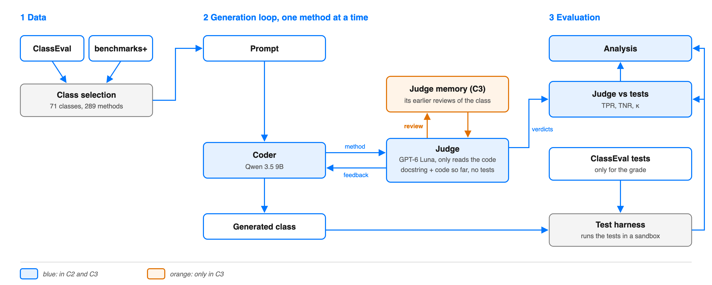
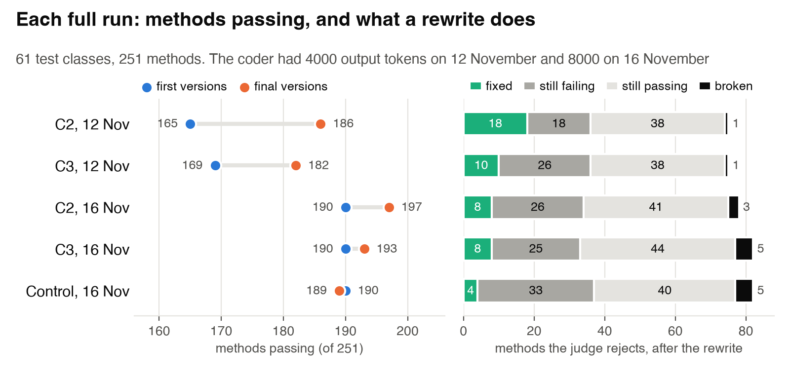
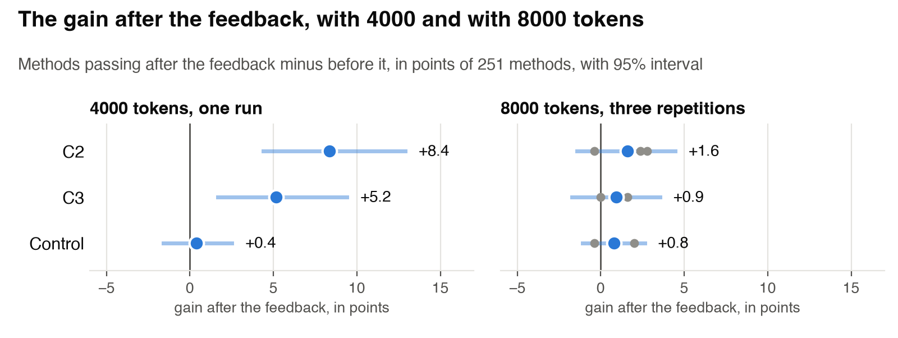
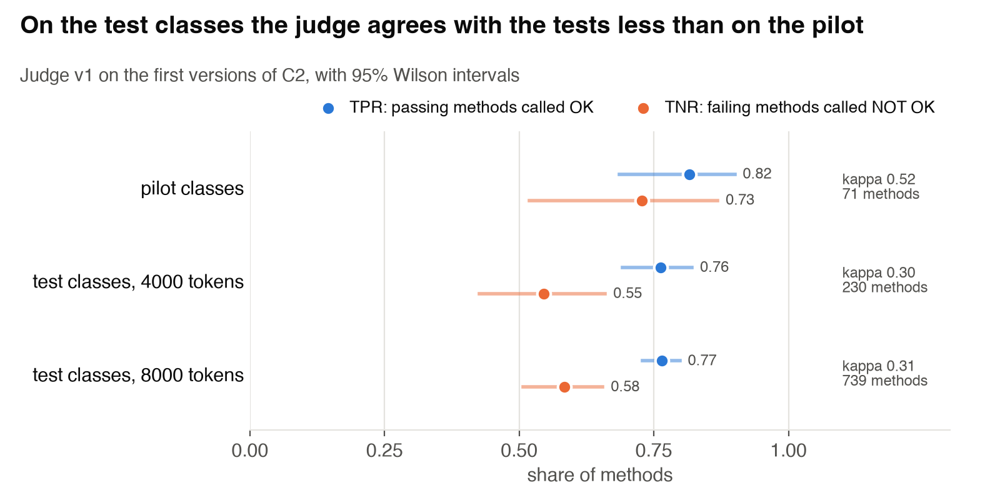
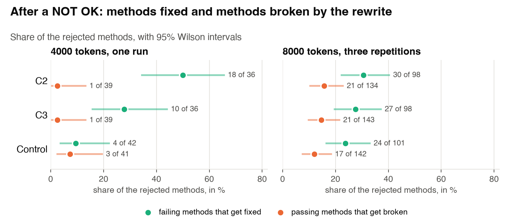

# Agent-As-a-Judge

**Project: Can a Judge Agent Make a Coding Agent Better?**
Dominik Panzarella and Daniele Buser, Neural Code Analysis, USI, autumn 2026.

A coding agent writes a Python class one method at a time, and a judge agent reviews each method.
We measure whether the judge's feedback makes the code pass more tests, and how often the judge
is wrong. The tasks come from ClassEval. Neither agent sees the tests: the judge works with the
docstrings and the code written so far, and the tests only give the grade.

In short: when the coder has few output tokens and its first versions are weak, the feedback
adds 8.4 points of methods passing, and the gain comes from the judge's reason. When the coder
has more tokens and its first versions are already good, the feedback adds nothing we can tell
from zero. The numbers are in [Results so far](#6-results-so-far).

## Contents

1. [Idea](#1-idea)
2. [How it works](#2-how-it-works)
3. [Quick start](#3-quick-start)
4. [Usage](#4-usage)
5. [Project layout](#5-project-layout)
6. [Results so far](#6-results-so-far)
7. [References and data](#7-references-and-data)

## 1. Idea

Agent-as-a-Judge (Zhuge et al., ICML 2025) uses an agent to judge another agent step by step. Its
future work suggests using the judge's verdicts as feedback during the work, and letting judge and
worker improve each other (a "flywheel"). We test both ideas on tasks with real tests:

- RQ1: Does the judge's feedback after every method make the coder write better code?
- RQ2: If the judge remembers its earlier reviews of the class, does the code get better?
- RQ3: How often is the judge wrong inside the loop?

## 2. How it works



Blue parts are in every setup; the orange part is only in C3.

Every setup has a coder and a judge:

| Setup | What happens after each method |
|---|---|
| C2 | the judge reviews the method; after a NOT OK the coder gets the reason and rewrites the method once |
| C3 | as C2, and the judge also reads its earlier reviews of the same class, its memory |
| Control | as C2, but after a NOT OK the coder learns the verdict without the reason |

There is no setup without the judge. The baseline is inside each setup: the first version of
each method, written before any feedback, against the final one. The control separates the
effect of the judge's reason from that of a second attempt.

All three ran with two limits of output tokens for the coder: 4000 per method, in one run, and
8000, in three repetitions.

**One method in C2.** (1) The coder writes the method. (2) The judge gets the skeleton with the
docstrings, the methods written so far and the new one, never the tests, and it runs no code.
(3) It answers OK or NOT OK with a reason. (4) After a NOT OK the
coder gets the reason in the same conversation and rewrites the method once. (5) The final version
joins the methods already written, and the next method starts. When the class is finished, the
harness runs all its tests on the first and on the final versions: that is the grade.

**Built**

- **Class selection.** 71 of the 100 ClassEval classes (289 methods): we drop the classes that
  benchmarks+ marks as problematic, plus two with trivial or broken methods. 10 are development
  classes for the pilot; the analysis uses the other 61. Methods follow the skeleton, except that a
  called method comes before its caller.
- **Prompt.** The class skeleton with all the docstrings, the methods written so far and the name
  of the next method.
- **Coder.** `qwen/qwen3.5-9b` on OpenRouter, with low reasoning effort. It writes one method at
  a time and rewrites it after a NOT OK, without ever seeing the tests or running code. Its limit
  is 8000 output tokens per request; the first run had 4000, and the instructors agreed to double
  it. The pilot also tried `qwen3.8-27b`, which already passes 82% of the methods.
- **Judge.** `gpt-6-luna` on OpenAI, with medium effort. It answers OK or NOT OK with a reason, and
  the reason is the feedback. The judge of the study is v1: it reads the docstrings and the code,
  runs nothing and never sees the tests. The pilot also tried judges that run code of their own
  (v2 to v5) and two variants of v1 (v6, v7). They agreed with the tests about as often as v1
  (kappa 0.47 to 0.54, v1 0.52), and two passes of v1 already differ on 7 of 71 verdicts, more
  than any variant gains. Two options are built and not used in the full runs: the judge can say
  how sure it is, from 0 to 100 (`--confidence`), and look at the method again when it is unsure
  (`--min-confidence`). On the pilot the confidence was 95 or more for 68 of 71 verdicts, right or
  wrong.
- **Control.** With `--no-reason` the coder learns after a NOT OK that the method was rejected,
  without the judge's reason. Through `--reuse` it starts from the first versions and reviews of
  its C2 run, so the two runs differ only in that message.
- **Judge memory (C3).** From the second method of a class, the judge's message lists its earlier
  reviews of that class: verdict, reason, and whether the method was then rewritten. It is the
  memory module of the paper, which stores past judgments and no ground truth.
- **Test harness.** Each ClassEval test class runs in its own process. A missing method becomes a
  stub, so it fails only its own tests. 4 methods pass even as stubs; we report results with and
  without them.
- **Judge vs tests.** After a run, the judge's verdict on each first version is set next to the
  grade of the same version. It gives TPR, TNR and Cohen's kappa, and the list of disagreements,
  which we check by hand after the midway report. It is not part of the loop.
- **Analysis.** McNemar tests paired by method and bootstrap intervals over classes.

**Where we are** (21 November)

- The judge's instructions are chosen, and C2, C3 and the control have run on the 61 test
  classes, once with 4000 tokens and three times with 8000. The
  [midway report](docs/Neural%20Code%20Analysis%20-%20Midway%20Reporting%20-%20Panzarella%20Buser.pdf)
  describes these runs.
- Next come our labels of the cases in which judge and tests disagree, three repetitions of C2
  and its control with 4000 tokens, and one or two variants of the judge. The dates are in the
  [roadmap](docs/roadmap_midway.md).

## 3. Quick start

Python 3.13, plus the OpenAI and OpenRouter keys from the course.

```bash
git clone https://github.com/DominikPanzarella/agent-as-a-judge.git
cd agent-as-a-judge
python3 -m venv .venv
.venv/bin/pip install -r requirements.txt
cp .env.example .env          # then write the two keys in .env (git ignores it)
./scripts/download_data.sh    # ClassEval and benchmarks+ -> data/raw/
```

## 4. Usage

Run everything from the repository root. The scripts that call a model accept `--dry-run` (print
the prompt, send nothing) and skip classes already done unless you pass `--force`.

```bash
# prepare and check the classes (outputs are already in data/selection/)
.venv/bin/python scripts/select_classes.py
.venv/bin/python scripts/order_methods.py
.venv/bin/python scripts/harness.py                    # references must pass, stubs must fail

# check the APIs and the budget
.venv/bin/python scripts/check_api.py
.venv/bin/python scripts/budget.py

# the coder alone, qwen3.5-9b with no judge (setup C0 of the pilot) -> runs/C0-9b
.venv/bin/python scripts/coder.py ClassEval_19 ClassEval_55
.venv/bin/python scripts/coder.py --all

# the judge on a finished run: v1 with medium effort by default (v6 and v7 also only read;
# v2 to v5, tried in the pilot, can also run code)
.venv/bin/python scripts/judge.py C0-9b --all

# C2 and C3: coder and judge together (the runs of 12 November, with 4000 tokens for the coder)
.venv/bin/python scripts/loop.py C2 --name C2-9b --classes test --max-tokens 4000
.venv/bin/python scripts/loop.py C3 --name C3-9b --reuse C2-9b --classes test --max-tokens 4000

# the three repetitions (r1, r2, r3) with 8000 tokens, each with its control without the reason
.venv/bin/python scripts/loop.py C2 --name C2-9b-8k-r1 --classes test
.venv/bin/python scripts/loop.py C3 --name C3-9b-8k-r1 --reuse C2-9b-8k-r1 --classes test
.venv/bin/python scripts/loop.py C2 --no-reason --name C2n-9b-8k-r1 --reuse C2-9b-8k-r1 --classes test

# results
.venv/bin/python scripts/pilot_report.py               # tables of the pilot
.venv/bin/python scripts/pilot_controls.py             # resampling control, judge TNR, power
.venv/bin/python scripts/plot_results.py               # charts -> docs/figures/
.venv/bin/python scripts/compare_judges.py             # the judge's prompts on the pilot classes
.venv/bin/python scripts/analyze.py --classes test C2-9b C3-9b
.venv/bin/python scripts/analyze.py --classes test --pool C2-9b-8k C3-9b-8k C2n-9b-8k   # the repetitions together
```

`analyze.py` reports pass rates before and after the feedback, the judge's TPR and TNR, what a
rewrite does after a NOT OK, McNemar tests and bootstrap intervals between runs; `--sample 20`
draws disagreements for the error analysis.

## 5. Project layout

```
docs/          diagrams, charts (figures/) and the roadmap
scripts/
  download_data.sh, select_classes.py, order_methods.py, pick_dev_classes.py   data
  harness.py, check_docstring_examples.py, check_field_order.py               checks
  coder.py, judge.py, loop.py, budget.py, check_api.py                         runs
  pilot_report.py, pilot_controls.py, check_claims.py, compare_judges.py,
  label_sheet.py, plot_results.py, analyze.py                                  results
data/selection/  the kept classes, method order, development classes, weak tests
runs/            one folder per run with a JSON file per class, plus cost_log.csv
```

Each JSON file in `runs/` holds, per method, the code, the judge's review and revision when there
is one, the token counts, the cost and the test result.

## 6. Results so far

All runs are on the 61 test classes (251 methods), with coder `qwen3.5-9b` and judge v1. The
chart shows every run: how many methods pass their tests before the feedback and after it.



**With 4000 output tokens, one run.** C2 and C3 ran on 12 November. The control ran on
19 November, on the first versions and reviews of that C2.

| | C2 | C3 | Control |
|---|---|---|---|
| Methods passing before the feedback | 165 (65.7%) | 169 (67.3%) | 164 (65.3%) |
| Methods passing after the feedback | 186 (74.1%) | 182 (72.5%) | 165 (65.7%) |
| Gain in points, with 95% interval | +8.4 [+4.4, +12.9] | +5.2 [+1.7, +9.4] | +0.4 [-1.6, +2.5] |
| Methods fixed, broken | 22, 1 | 14, 1 | 4, 3 |
| NOT OK and rewrites | 75 | 75 | 83 |
| Judge against the tests: TPR, TNR, kappa | 0.76, 0.55, 0.30 | 0.77, 0.59, 0.33 | 0.75, 0.61, 0.34 |
| Cost | 0.18 $ | 0.09 $ | 0.08 $ |

**With 8000 output tokens, three repetitions** (16 and 17 November). Methods passing before and
after the feedback, of 251 per run:

| | C2 | C3 | Control |
|---|---|---|---|
| Repetition 1 | 190 → 197 | 190 → 193 | 190 → 189 |
| Repetition 2 | 191 → 190 | 192 → 192 | 192 → 197 |
| Repetition 3 | 190 → 196 | 190 → 194 | 186 → 188 |
| Together, of 753 | 571 → 583 | 572 → 579 | 568 → 574 |
| Gain in points, with 95% interval | +1.6 [-1.4, +4.5] | +0.9 [-1.7, +3.5] | +0.8 [-1.1, +2.6] |
| Methods fixed, broken | 34, 22 | 29, 22 | 24, 18 |
| NOT OK and rewrites | 232 | 241 | 243 |
| Cost of the three runs | 0.36 $ | 0.34 $ | 0.26 $ |



- **RQ1, does the feedback improve the code?** With 4000 tokens it does. C2 gains 8.4 points and
  the control 0.4, so a second attempt alone gives almost nothing and the gain comes from the
  judge's reason. The control ends 8.4 points below C2 [-13.5, -3.7], McNemar p < 0.001. On the
  23 failing methods that the same review rejects in both, the coder fixes 8 with the reason and
  1 without it. With 8000 tokens about 190 methods already pass before any feedback, and the gain
  of C2 is 1.6 points, with an interval that includes zero. The control ends 1.2 points below C2
  [-3.0, +0.8]. On the 138 methods that the same review rejects in both, the coder fixes 10 and
  breaks 11 with the reason, 9 and 8 without it.
- **RQ2, does the judge's memory help?** It does not, under either limit. C3 against C2 is -1.6
  points [-4.7, +1.5] with 4000 tokens and -0.5 [-2.0, +1.0] with 8000. On the same code the
  memory changes 10 of 95 verdicts in the first case and 30 of 359 in the second, about as often
  as two passes of the same judge differ on the pilot (7 of 71).
- **RQ3, how often is the judge wrong?** Against the tests it accepts about three in four of the
  methods that pass and rejects a little more than half of those that fail. Its kappa is 0.30
  with 4000 tokens and 0.31 with 8000, against 0.52 on the pilot classes. More than half of its
  rejections hit methods that already pass. Whether the judge or the tests are wrong in those
  cases needs our labels.



Read together, the two limits say that the feedback helps a coder in difficulty and stops
helping once the first versions are good. With 4000 tokens and the feedback the coder reaches
186 methods, close to the 190 that 8000 tokens give without any feedback.

### Comparing the setups

The table puts the six conditions side by side. For each it gives the share of the 251 methods
that pass before and after the feedback, the methods the judge rejects, those that go from
failing to passing (fixed) and those that go from passing to failing (broken). With 8000 tokens
the three repetitions are added up.

| | Pass before | Pass after | Rejected | Fixed | Broken |
|---|---|---|---|---|---|
| 4000 tokens, C2 | 65.7% | 74.1% | 75 | 22 | 1 |
| 4000 tokens, C3 | 67.3% | 72.5% | 75 | 14 | 1 |
| 4000 tokens, control | 65.3% | 65.7% | 83 | 4 | 3 |
| 8000 tokens, C2 | 75.8% | 77.4% | 232 | 34 | 22 |
| 8000 tokens, C3 | 76.0% | 76.9% | 241 | 29 | 22 |
| 8000 tokens, control | 75.4% | 76.2% | 243 | 24 | 18 |



The chart counts the rejected methods alone. In the table, fixed and broken also include a few
methods whose result changes because another method of their class was rewritten.

- C3 never does better than C2. With 4000 tokens the two judges reject 36 failing and 39 passing
  methods each, and the rewrite fixes 18 of the failing ones in C2 against 10 in C3. With 8000
  tokens the two are level.
- The judge's reason matters when the coder struggles. With 4000 tokens the rewrite fixes half of
  the rejected failing methods with the reason and 4 of 42 without it. With 8000 tokens the
  reason still fixes a few more (31% against 24%) but also breaks more passing methods (16%
  against 12%), so C2 and the control end level.
- A wrong rejection does more damage with 8000 tokens. The rewrite breaks 1 of 39 passing
  methods under the lower limit and 21 of 134 under the higher one, and more than half of the
  judge's rejections fall on passing methods.
- With 4000 tokens the gain of C2 sits in the methods written later in the class. The first
  method goes from 69% to 70%, the fourth and later ones from 68% to 82%.
- The coder changes from one run to the next. Across the three repetitions of C2 with 8000
  tokens, 163 methods pass at the first attempt every time, 36 never do and 52 change. In the
  nine runs with 8000 tokens, 25 methods never pass, before or after the feedback.

Three things limit these results. The gain with 4000 tokens comes from one run. Its control ran
a week later, on another provider of the same model. With 4000 tokens, 21 of the 251 first
replies of C2 (8%) had no usable method because the coder spent the limit on reasoning; they
get no review and count as failing. With 8000 tokens they are 4 or 5 per run.

The numbers come from `analyze.py --classes test C2-9b C3-9b C2n-9b` and
`analyze.py --classes test --pool C2-9b-8k C3-9b-8k C2n-9b-8k`. All the runs so far cost
1.83 $ of the 20 $ available.

## 7. References and data

- Zhuge et al., "Agent-as-a-Judge: Evaluate Agents with Agents", ICML 2025.
  https://arxiv.org/abs/2410.10934
- Du et al., "ClassEval: A Manually-Crafted Benchmark for Evaluating LLMs on Class-level Code
  Generation", 2023. https://arxiv.org/abs/2308.01861 (data: CC BY-NC 4.0)
- benchmarks+, from "Examining Benchmark Quality in Code Generation".
  https://doi.org/10.5281/zenodo.21031875 (data: CC BY 4.0)

The data sets are not stored here; `scripts/download_data.sh` fetches them.

Course: Neural Code Analysis, USI, Prof. Gabriele Bavota, with Alessandro Giagnorio as teaching
assistant. The course provided the OpenAI project and the OpenRouter key.
