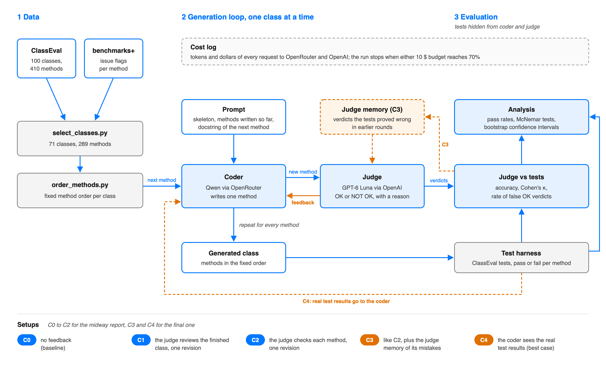

# Agent-As-a-Judge
Neural Code Analysis Course Paper Presentation and Project

**Project: Can a Judge Agent Make a Coding Agent Better?** (Dominik Panzarella, Daniele Buser)

We test the future work of Agent-as-a-Judge (Zhuge et al., ICML 2025). A judge agent gives feedback
after every method while a coding agent writes a class. We run this on ClassEval (Du et al., 2023),
whose tests tell us who is right.



The plan up to the midway report, with what is done and what is still open, is in
[docs/roadmap_midway.md](docs/roadmap_midway.md).

## Setup

```bash
cp .env.example .env          # add the API keys, never commit .env
./scripts/download_data.sh    # ClassEval + benchmarks+ into data/raw/ (not tracked)
python3 scripts/benchmark_stats.py
python3 scripts/select_classes.py
python3 scripts/order_methods.py
```

## Data

- ClassEval: https://github.com/FudanSELab/ClassEval (CC BY-NC 4.0)
- benchmarks+ from "Examining Benchmark Quality in Code Generation":
  https://doi.org/10.5281/zenodo.21031875 (CC BY 4.0), used to drop trivial and problematic tasks

## Class selection

`scripts/select_classes.py` writes `data/selection/classes.csv`, one row per class with the reason for
each drop. We drop a class when benchmarks+ marks one of its methods as problematic, since its tests
then cannot say whether the code is right. This removes 27 classes. We also drop the one class whose
methods are all trivial: all nine models tested in benchmarks+ solve them. The remaining 72 classes
have 295 methods.

## Method order

`scripts/order_methods.py` writes `data/selection/method_order.csv`. The coder writes the methods of a
class in the order of its skeleton, which we take as the logical order chosen by the ClassEval
authors. We change that order only where a method calls another method of the same class: the called
method comes first. This changes the position of 48 of the 295 methods, in 15 classes. One ClassEval
annotation is wrong. In ClassEval_63, `process_data` does not call `process`, so we remove that
dependency, which would otherwise create a cycle.
