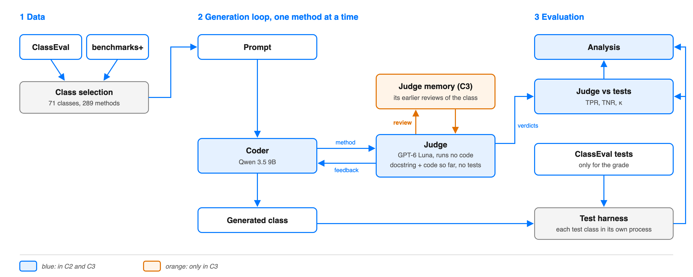
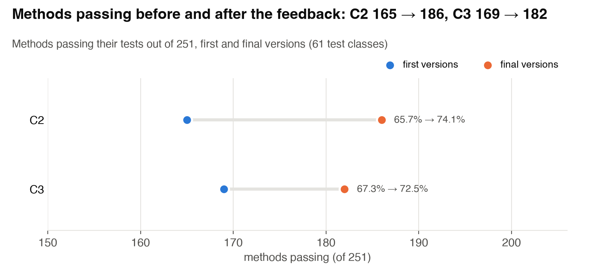
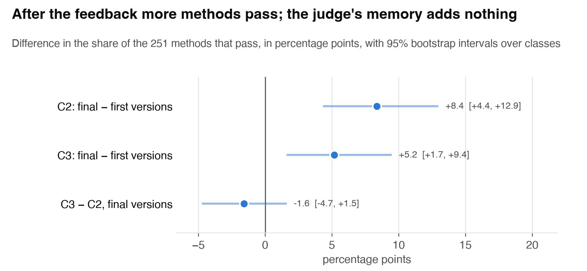
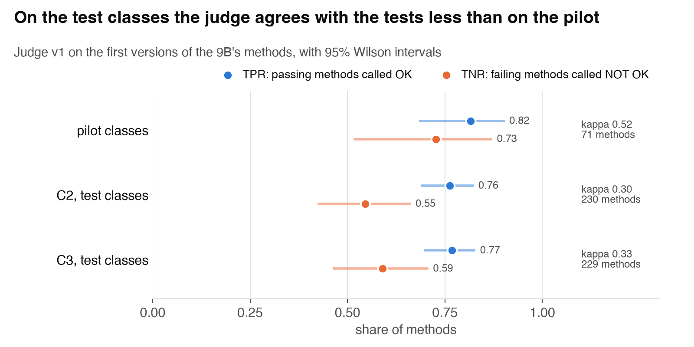

# Agent-As-a-Judge

**Project: Can a Judge Agent Make a Coding Agent Better?**
Dominik Panzarella and Daniele Buser, Neural Code Analysis, USI, autumn 2026.

A coding agent writes a Python class one method at a time, and a judge agent reviews the work. We
measure whether the judge's feedback makes the code pass more tests, and how often the judge is
wrong. The tasks come from ClassEval. Neither agent sees the tests: the judge works only with what
exists when the code is written (the docstring and the code so far), and the tests only give the
grade.

## Contents

1. [Idea](#1-idea)
2. [How it works](#2-how-it-works)
3. [Quick start](#3-quick-start)
4. [Usage](#4-usage)
5. [Project layout](#5-project-layout)
6. [Results so far](#6-results-so-far)
7. [References and data](#7-references-and-data)

## 1. Idea

Agent-as-a-Judge (Zhuge et al., ICML 2025) uses an agent to judge another agent step by step. Its
future work suggests using the judge's verdicts as feedback during the work, and letting judge and
worker improve each other (a "flywheel"). We test both ideas on tasks with real tests:

- RQ1: Does the judge's feedback after every method make the coder write better code?
- RQ2: If the judge remembers its earlier reviews of the class, does the code get better?
- RQ3: How often is the judge wrong inside the loop?

## 2. How it works



Blue parts are in both setups; the orange part is only in C3.

Both setups have a coder and a judge:

| Setup | Feedback to the coder | Status |
|---|---|---|
| C2 | after each method the judge reviews it; one revision of that method, then the next method | run on the 61 test classes |
| C3 | as C2, and the judge also reads its earlier reviews of the same class (its memory); nothing from the tests reaches it | run on the 61 test classes |

There is no setup without the judge: the baseline is inside each setup, in the first version of
each method, written before any feedback.

**One method in C2.** (1) The coder writes the method. (2) The judge gets the skeleton with the
docstrings, the methods written so far and the new one, never the tests, and it runs no code.
(3) It answers OK or NOT OK with a reason. (4) After a NOT OK the
coder gets the reason in the same conversation and rewrites the method once. (5) The final version
joins the methods already written, and the next method starts. When the class is finished, the
harness runs all its tests on the first and on the final versions: that is the grade.

**Built**

- **Class selection.** 71 of the 100 ClassEval classes (289 methods): we drop the classes that
  benchmarks+ marks as problematic, plus two with trivial or broken methods. 10 are development
  classes for the pilot; the analysis uses the other 61. Methods follow the skeleton, except that a
  called method comes before its caller.
- **Prompt.** The class skeleton with all the docstrings, the methods written so far and the name
  of the next method.
- **Coder.** `qwen/qwen3.5-9b` on OpenRouter (chosen on 11 November; the pilot also used
  `qwen3.8-27b`, which already passes 82% of the methods), with low reasoning effort and 4000 output
  tokens per request. It writes one method at a time and rewrites it after a NOT OK, without ever
  seeing the tests or running code.
- **Judge.** `gpt-6-luna` on OpenAI, with medium effort. It answers OK or NOT OK with a reason, and
  the reason is the feedback. The judge of the study is v1: it reads the docstrings and the code,
  runs nothing and never sees the tests. The pilot also tried judges that run code of their own (v2 to v5), which agreed with
  the tests about as often (kappa 0.50 to 0.54, v1 0.52), and two variants of v1 itself (v6, v7),
  which did not beat it: between two passes of v1, 7 of 71 verdicts change, more than either
  variant gains. Two options are built and not used in the full runs: the judge adds to the
  verdict how sure it is, from 0 to 100 (`--confidence`), and below a threshold it looks at the
  method again, at most twice (`--min-confidence`). On the pilot classes the confidence was 95
  or more for 68 of 71 verdicts, right or wrong.
- **Judge memory (C3).** From the second method of a class, the judge's message lists its earlier
  reviews of that class: verdict, reason, and whether the method was then rewritten. It is the
  memory module of the paper, which stores past judgments and no ground truth.
- **Test harness.** Each ClassEval test class runs in its own process. A missing method becomes a
  stub, so it fails only its own tests. 4 methods pass even as stubs; we report results with and
  without them.
- **Judge vs tests.** Not part of the loop: after a run, the judge's verdict on each first version is
  set next to the grade of the same version. It gives TPR, TNR and Cohen's kappa, and the list of
  disagreements. We check them by hand after the midway report.
- **Analysis.** McNemar tests paired by method and bootstrap intervals over classes.

**Plan for the midway report** (12 November)

- **The judge on the pilot classes** (done). Seven prompts tried on the 9B's methods of the 10 pilot
  classes; none beats v1 by more than a judge differs from its own repeat, so the study uses v1.
- **One full run of C2** (done) on the 61 test classes, then a report of the budget spent.
- **One full run of C3** (done) on the same classes. It takes from C2 every first version and review
  whose input is the same (`--reuse`), so the two runs differ only where the memory changes a
  verdict.

After the midway: our labels and the error analysis, the control without feedback and the
repetitions on the 61 classes, a judge that writes tests of its own from the docstring and runs
them, more than one rewrite when the judge is sure, and the other variants in the
[roadmap](docs/roadmap_midway.md).

## 3. Quick start

Python 3.13, plus the OpenAI and OpenRouter keys from the course.

```bash
git clone https://github.com/DominikPanzarella/agent-as-a-judge.git
cd agent-as-a-judge
python3 -m venv .venv
.venv/bin/pip install -r requirements.txt
cp .env.example .env          # then write the two keys in .env (git ignores it)
./scripts/download_data.sh    # ClassEval and benchmarks+ -> data/raw/
```

## 4. Usage

Run everything from the repository root. The scripts that call a model accept `--dry-run` (print
the prompt, send nothing) and skip classes already done unless you pass `--force`.

```bash
# prepare and check the classes (outputs are already in data/selection/)
.venv/bin/python scripts/select_classes.py
.venv/bin/python scripts/order_methods.py
.venv/bin/python scripts/harness.py                    # references must pass, stubs must fail

# check the APIs and the budget
.venv/bin/python scripts/check_api.py
.venv/bin/python scripts/budget.py

# the coder alone, qwen3.5-9b with no judge (setup C0 of the pilot) -> runs/C0-9b
.venv/bin/python scripts/coder.py ClassEval_19 ClassEval_55
.venv/bin/python scripts/coder.py --all

# the judge on a finished run: v1 with medium effort by default (v6 and v7 also only read;
# v2 to v5, tried in the pilot, can also run code)
.venv/bin/python scripts/judge.py C0-9b --all

# C2 and C3: coder and judge together
.venv/bin/python scripts/loop.py C2 --name C2-9b --classes test
.venv/bin/python scripts/loop.py C3 --name C3-9b --reuse C2-9b --classes test

# results
.venv/bin/python scripts/pilot_report.py               # tables of the pilot
.venv/bin/python scripts/pilot_controls.py             # resampling control, judge TNR, power
.venv/bin/python scripts/plot_results.py               # charts -> docs/figures/
.venv/bin/python scripts/compare_judges.py             # the judge's prompts on the pilot classes
.venv/bin/python scripts/analyze.py --classes test C2-9b C3-9b
```

`analyze.py` reports pass rates before and after the feedback, the judge's TPR and TNR, McNemar
tests and bootstrap intervals between runs; `--sample 20` draws disagreements for the error
analysis.

## 5. Project layout

```
docs/          diagrams, charts (figures/) and the roadmap
scripts/
  download_data.sh, select_classes.py, order_methods.py, pick_dev_classes.py   data
  harness.py, check_docstring_examples.py, check_field_order.py               checks
  coder.py, judge.py, loop.py, budget.py, check_api.py                         runs
  pilot_report.py, pilot_controls.py, check_claims.py, compare_judges.py,
  label_sheet.py, plot_results.py, analyze.py                                  results
data/selection/  the kept classes, method order, development classes, weak tests
runs/            one folder per run with a JSON file per class, plus cost_log.csv
```

Each JSON file in `runs/` holds, per method, the code, the judge's review and revision when there
is one, the token counts, the cost and the test result.

## 6. Results so far

One full run of each setup on the 61 test classes (251 methods), on 12 November: coder
`qwen3.5-9b`, judge v1 with medium effort.

| | C2 | C3 |
|---|---|---|
| Methods passing, first versions | 165 (65.7%) | 169 (67.3%) |
| Methods passing, final versions | 186 (74.1%) | 182 (72.5%) |
| Final minus first, in points, with 95% interval | +8.4 [+4.4, +12.9] | +5.2 [+1.7, +9.4] |
| Methods fixed, broken | 22, 1 | 14, 1 |
| NOT OK and revisions | 75 | 75 |
| Judge on first versions: TPR, TNR, kappa | 0.76, 0.55, 0.30 | 0.77, 0.59, 0.33 |
| Cost | 0.18 $ | 0.09 $ |



- **RQ1.** After the feedback more methods pass in both setups. In the pilot, rewriting a
  rejected method without feedback did about as well, so the gain is feedback and second
  attempt together; the full runs have no such control yet.
- **RQ2.** C3 against C2 on the final versions: -1.6 points [-4.7, +1.5], McNemar p = 0.42.
  With the memory the judge changes 10 of 95 verdicts on the same code, as many as between two
  passes of the same judge on the pilot (7 of 71).



- **RQ3.** Against the tests the judge has a kappa of 0.30 on the test classes and 0.52 on the
  pilot ones. Who is wrong, the judge or the tests, needs our labels, after the midway.



In C2, 21 of the 251 first replies (8%) had no usable method: the coder spent its 4000 tokens
on reasoning. They get no review and count as failing before and after.

## 7. References and data

- Zhuge et al., "Agent-as-a-Judge: Evaluate Agents with Agents", ICML 2025.
  https://arxiv.org/abs/2410.10934
- Du et al., "ClassEval: A Manually-Crafted Benchmark for Evaluating LLMs on Class-level Code
  Generation", 2023. https://arxiv.org/abs/2308.01861 (data: CC BY-NC 4.0)
- benchmarks+, from "Examining Benchmark Quality in Code Generation".
  https://doi.org/10.5281/zenodo.21031875 (data: CC BY 4.0)

The data sets are not stored here; `scripts/download_data.sh` fetches them.

Course: Neural Code Analysis, USI, Prof. Gabriele Bavota, with Alessandro Giagnorio as teaching
assistant. The course provided the OpenAI project and the OpenRouter key.
