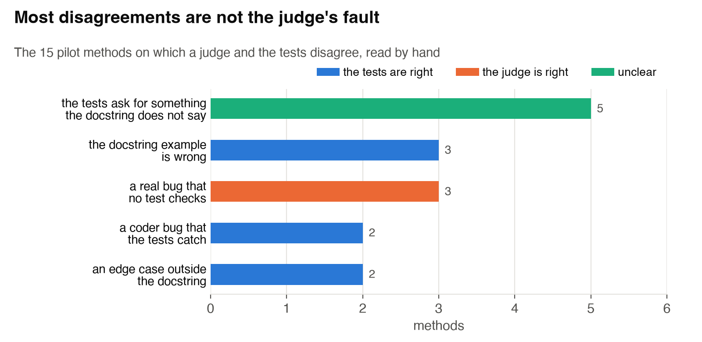
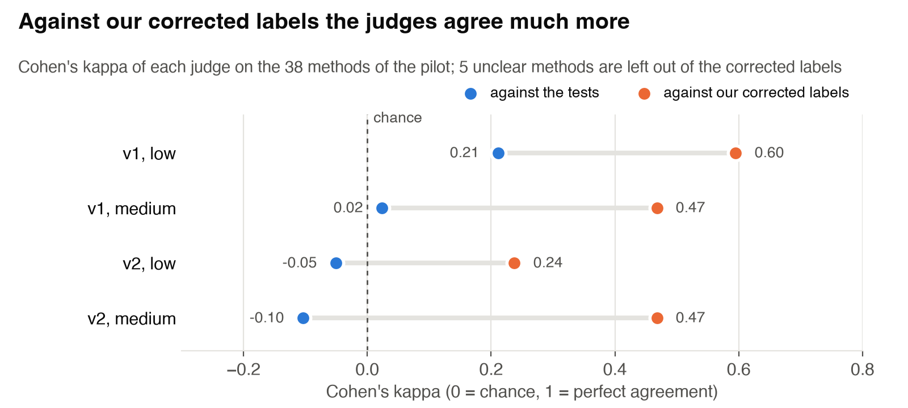
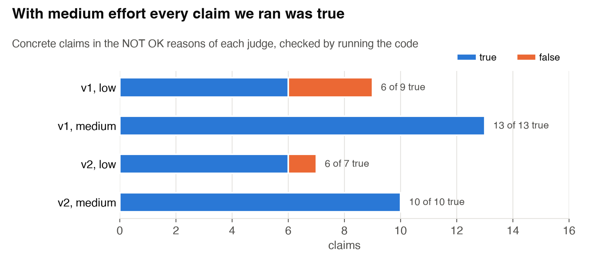
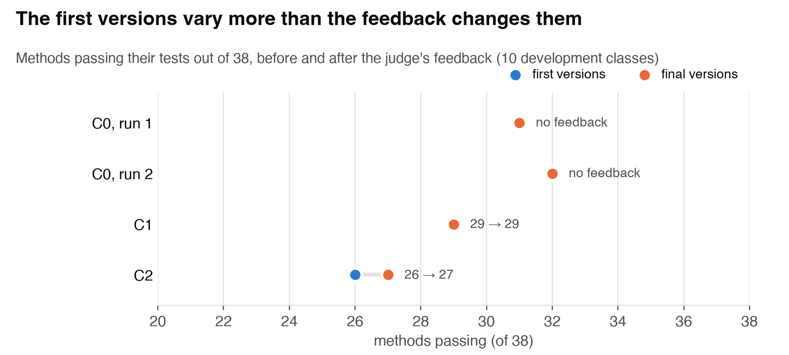
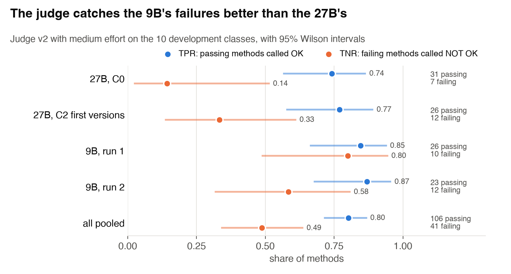

# Agent-As-a-Judge
Neural Code Analysis Course Paper Presentation and Project

**Project: Can a Judge Agent Make a Coding Agent Better?**
Dominik Panzarella and Daniele Buser, Neural Code Analysis, USI, autumn 2026.

A coding agent writes a Python class one method at a time, and a judge agent reviews the work. We
measure whether the judge's feedback makes the code pass more tests, and how often the judge is
wrong. The tasks come from ClassEval, whose tests stay hidden from both agents.

## Contents

1. [Idea](#1-idea)
2. [How it works](#2-how-it-works)
3. [Quick start](#3-quick-start)
4. [Usage](#4-usage)
5. [Project layout](#5-project-layout)
6. [Results so far](#6-results-so-far)
7. [References and data](#7-references-and-data)

## 1. Idea

Agent-as-a-Judge (Zhuge et al., ICML 2025) uses an agent to judge another agent step by step. Its
future work suggests using the judge's verdicts as feedback during the work, and letting judge and
worker improve each other (a "flywheel"). We test both ideas on tasks with real tests:

- RQ1: Does the coder write better code with feedback after every method, at the end, or never?
- RQ2: If the judge remembers the mistakes the tests caught, do judge and coder improve over time?
- RQ3: How often is the judge wrong inside the loop, and does the coder learn to please it?

## 2. How it works


Solid parts are built and were tried in the pilot; orange, dashed parts are proposed or planned.
The first diagram, from before the pilot, is in `docs/architecture.svg`.

We keep coder and tasks fixed and change only the feedback:

| Setup | Feedback to the coder | Status |
|---|---|---|
| C0 | none (baseline) | piloted |
| C1 | the judge reviews the finished class; one revision of the class | piloted |
| C2 | the judge reviews each method; one revision of that method | piloted |
| C3 | as C2, plus a memory of the judge's mistakes | planned |
| C4 | the coder sees the real test results (best case) | planned |

**Built**

- **Class selection.** 71 of the 100 ClassEval classes (289 methods): we drop the classes that
  benchmarks+ marks as problematic, plus two with trivial or broken methods. 10 are development
  classes for the pilot; the analysis uses the other 61. Methods follow the skeleton, except that a
  called method comes before its caller.
- **Prompt.** The class skeleton, the methods written so far and the docstring of the next method.
- **Coder.** `qwen/qwen3.8-27b` on OpenRouter, in bf16, with low reasoning effort and 4000 output
  tokens per request. It writes one method at a time and rewrites it after a NOT OK.
- **Judge.** `gpt-6-luna` on OpenAI, with medium effort. It answers OK or NOT OK with a reason, and
  the reason is the feedback. v1 only reads the code; v2 can also run it up to 5 times.
- **Test harness.** Each ClassEval test class runs in its own process. A missing method becomes a
  stub, so it fails only its own tests. 4 methods pass even as stubs; we report results with and
  without them.
- **Judge vs tests and labels.** TPR, TNR and Cohen's kappa of the judge's verdicts.
- **Analysis.** McNemar tests paired by method and bootstrap intervals over classes.

**Proposed** (numbered as in the diagram; reasons and sources are in the
[roadmap](docs/roadmap_midway.md))

1. **First versions of C0.** C1 and C2 reuse them, so the setups differ only after the feedback.
2. **Our labels.** We label the methods by hand, with criteria written first, and measure the judge
   against these labels too.
3. **Feedback with evidence.** The coder also gets the code the judge ran and its output.
4. **Judge v3.** One check per docstring requirement, and a NOT SPECIFIED verdict that never
   reaches the coder.
5. **Judge memory.** In C3 the judge keeps only the corrections we confirm by hand.
6. **Controls.** Empty feedback (NOT OK without the reason) and resampling (the method written
   again without feedback).

## 3. Quick start

Python 3.13, plus the OpenAI and OpenRouter keys from the course.

```bash
git clone https://github.com/DominikPanzarella/agent-as-a-judge.git
cd agent-as-a-judge
python3 -m venv .venv
.venv/bin/pip install -r requirements.txt
cp .env.example .env          # then write the two keys in .env (git ignores it)
./scripts/download_data.sh    # ClassEval and benchmarks+ -> data/raw/
```

## 4. Usage

Run everything from the repository root. The scripts that call a model accept `--dry-run` (print
the prompt, send nothing) and skip classes already done unless you pass `--force`.

```bash
# prepare and check the classes (outputs are already in data/selection/)
.venv/bin/python scripts/select_classes.py
.venv/bin/python scripts/order_methods.py
.venv/bin/python scripts/harness.py                    # references must pass, stubs must fail

# check the APIs and the budget
.venv/bin/python scripts/check_api.py
.venv/bin/python scripts/budget.py

# C0: the coder alone
.venv/bin/python scripts/coder.py ClassEval_19 ClassEval_55
.venv/bin/python scripts/coder.py --all

# the judge on a finished run (v1 reads, v2 can also run code)
.venv/bin/python scripts/judge.py C0 --version v2 --effort medium --all

# C1 and C2: coder and judge together
.venv/bin/python scripts/loop.py C2 --judge v2 --effort medium --all

# results
.venv/bin/python scripts/pilot_report.py               # tables of the pilot
.venv/bin/python scripts/pilot_controls.py             # resampling control, judge TNR, power
.venv/bin/python scripts/plot_results.py               # charts -> docs/figures/
.venv/bin/python scripts/analyze.py --classes test C0 C1-v2-medium C2-v2-medium --sample 20
```

`analyze.py` reports pass rates, the judge's TPR and TNR, McNemar tests and bootstrap intervals
between runs; `--sample 20` draws disagreements for the error analysis.

## 5. Project layout

```
docs/          diagrams, charts (figures/) and the roadmap
scripts/
  download_data.sh, select_classes.py, order_methods.py, pick_dev_classes.py   data
  harness.py, check_docstring_examples.py, check_field_order.py               checks
  coder.py, judge.py, loop.py, budget.py, check_api.py                         runs
  pilot_report.py, pilot_controls.py, check_claims.py, plot_results.py,
  analyze.py                                                                   results
data/selection/  the kept classes, method order, development classes, weak tests
runs/            one folder per run with a JSON file per class, plus cost_log.csv
```

Each JSON file in `runs/` holds, per method, the code, the judge's review and revision when there
is one, the token counts, the cost and the test result.

## 6. Results so far

These come from the pilot on the 10 development classes (38 methods), not from the study.

**The coder.** Two identical runs of qwen3.8-27b pass 31 and 32 methods, and 3 methods change
result by chance. qwen3.5-9b passes fewer (26 and 23) but changes 7.

**The judge against the tests and against our labels.** Against the tests the judges look close to
chance. We read the 15 disputed methods by hand: often the tests, not the judge, are the problem.



With these corrected labels (5 unclear methods left out), the agreement rises a lot:



**The judge's claims.** We ran every concrete claim in the NOT OK reasons. With medium effort all
of them were true, so the loops use v2 with medium effort.



**C1 and C2.** In C2 the revisions fixed 3 methods and broke 2; in C1 they changed nothing. Both
setups end below C0, but their first versions were already worse before any feedback. The coder's
randomness is as large as the effect we want to measure, so we propose to start every setup from
the first versions of C0.



**Two checks** (`pilot_controls.py`). We replaced the methods the judge rejects with the same
methods from a second run, written without feedback. In each run we tried, this fixes 0 to 2 and
breaks 1, while C2 fixed 3 and broke 2: on 10 classes the judge's reason does not yet beat a
second attempt, so the full runs need this control. The judge also catches 15 of 22 failing
methods written by the 9B, but only 5 of 19 written by the 27B. In C0, 5 of the 27B's 7 failures
come from tests that ask for something the docstring does not say, which a judge reading the
docstring cannot catch.



The open questions (coder, conflicting tests, repetitions, proposals) are in the
[roadmap](docs/roadmap_midway.md).

## 7. References and data

- Zhuge et al., "Agent-as-a-Judge: Evaluate Agents with Agents", ICML 2025.
  https://arxiv.org/abs/2410.10934
- Du et al., "ClassEval: A Manually-Crafted Benchmark for Evaluating LLMs on Class-level Code
  Generation", 2023. https://arxiv.org/abs/2308.01861 (data: CC BY-NC 4.0)
- benchmarks+, from "Examining Benchmark Quality in Code Generation".
  https://doi.org/10.5281/zenodo.21031875 (data: CC BY 4.0)

The data sets are not stored here; `scripts/download_data.sh` fetches them.

Course: Neural Code Analysis, USI, Prof. Gabriele Bavota, with Alessandro Giagnorio as teaching
assistant. The course provided the OpenAI project and the OpenRouter key.
