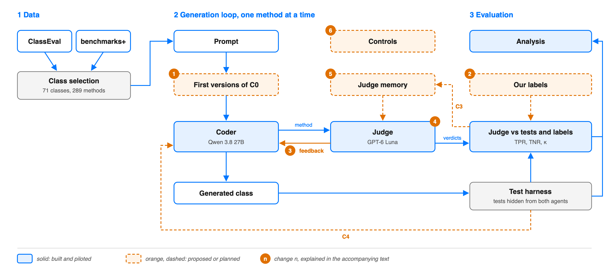

# Roadmap to the midway report (19 November 2026) and beyond

The midway report is at most 2 pages, uploaded on iCorsi by midnight of 19 November. It needs the
title, the team, the changes to the plan, the status with numbers, and a schedule until
16 December. Tick a box by changing `[ ]` into `[x]`.

Blue is built, orange is proposed or planned. The source is `architecture_proposed.svg`.

## Course dates

- 12 and 16 November: labs.
- 19 November: midway report, by midnight.
- 23 or 26 November: 1-to-1 meetings, if the instructors call us.
- 14 December: last lab.
- 16 December: final report, at most 10 pages plus 2 for references.
- 17 December: 5-minute presentation.

## Done

- [x] **Data and classes.** 71 of the 100 ClassEval classes, 289 methods (`select_classes.py`).
- [x] **Method order** (`order_methods.py`). Checked against the fields too: no change needed.
- [x] **Test harness** (5 Nov). References pass all 289 methods; 4 methods pass even as stubs.
- [x] **APIs** (6 Nov). Coder qwen3.8-27b in bf16 (qwen3.6-27b has no full-precision provider),
  judge GPT-6 Luna.
- [x] **Coder, setup C0** (6 Nov). One method per request, never seeing the tests.
- [x] **Judge v1 and v2** (6 Nov). v1 reads the code; v2 can also run it, up to 5 times.
- [x] **Pilot** (7 Nov, 10 development classes, 38 methods). Against the tests the judge looks close
  to chance (kappa at most 0.21). Against our labels of the 15 disputed methods it reaches 0.60,
  because the tests often check things the docstring does not say. With medium effort all the
  judge's concrete claims were true, so we keep the judge with medium effort.
- [x] **Setups C1 and C2 on the development classes** (7 Nov). C2: 3 methods fixed, 2 broken. C1:
  no change. Both start from worse first versions than C0, so the coder's randomness hides the
  effect of the feedback.

## Week 2 (9 to 15 November)

- [ ] **Full runs** (11 to 13 Nov). C0, C1 and C2 on the 71 classes, after the instructors' answer.
  About one dollar per setup.
- [ ] **Analysis** (14 to 15 Nov). Pass rates with and without the weak methods, the judge's TPR
  and TNR, McNemar tests and bootstrap intervals (`analyze.py`).
- [ ] **Error analysis** (14 to 15 Nov). 20 disagreements between judge and tests, grouped into
  kinds, deciding each time who is right (`analyze.py --sample 20`).

## 16 to 19 November: midway report

- [ ] **Draft** (16 Nov), to bring to the lab.
- [ ] **Submission** (19 Nov).

## After the midway (20 November to 17 December)

- [ ] **C3, the flywheel** (20 to 29 Nov). Three rounds of classes; between rounds the judge keeps
  a memory of its mistakes.
- [ ] **C4 and the controls** (30 Nov to 6 Dec). C4 gives the coder the real test results. Controls:
  judge v1 (no tools) and self-refine.
- [ ] **Full analysis** (7 to 11 Dec), answering RQ1, RQ2 and RQ3.
- [ ] **Final report** (7 to 16 Dec), with a draft at the lab of 14 December.
- [ ] **Presentation** (17 Dec).

## Proposals to discuss with the instructors

Each comes with its reason and source.

- [ ] **Same first versions in every setup.** C1 and C2 reuse the first versions of C0 while the
  prompt is identical, since two identical C0 runs differ by 3 methods, as much as the feedback.
- [ ] **Our labels next to the tests, with TPR and TNR.** The paper judges its judge against human
  experts, and our tests and docstrings often disagree. We write the labelling criteria first,
  because people change them while labelling (Shankar et al. 2024, "criteria drift").
- [ ] **Feedback with evidence.** The coder also gets the code the judge ran and its output.
  Grounded critiques work better (CRITIC, Gou et al. 2024), and the judge's medium-effort claims
  were all true.
- [ ] **Judge v3, one docstring requirement at a time**, like the paper's ask module. Both methods
  broken in C2 were correct code rejected for behaviour the docstring does not describe.
- [ ] **A careful memory in C3**: only corrections we confirm by hand, at most about ten. The paper
  found its memory module harmful, because errors spread to later verdicts.
- [ ] **Control with empty feedback** (NOT OK without the reason), to separate the effect of the
  reason from that of a second attempt.
- [ ] **The judge as an evaluator.** TPR and TNR from the development classes correct the judge's
  pass rate on the other 61 classes (Rogan and Gladen formula).
- [ ] **pass^k if we repeat runs**: the share of methods that pass in all k runs (from τ-bench).

Sources: Zhuge et al. 2025 (the paper); lessons 03 and 05 of phase 14 of AI Engineering from
Scratch (https://github.com/DominikPanzarella/ai-engineering-from-scratch); lectures 4, 5 and 14
of Engineering AI Systems, USI
(https://www.composablesystems.org/courses/engineering-ai-systems/fa2026/).

## Open decisions

- [ ] **Coder.** qwen3.8-27b passes 82% of the methods and leaves little room for feedback;
  qwen3.5-9b passes fewer but is less stable.
- [ ] **Repetitions.** One run per setup, or two or three.
- [ ] **Same budget across setups.** For now: one revision per method in C2, one per class in C1.
- [ ] **The lab note "classes with the 1st methods implemented".** To ask Alessandro.
- [x] **Judge effort** (7 Nov). Medium: its claims were all true, at about 0.09 dollars per 289
  methods.
