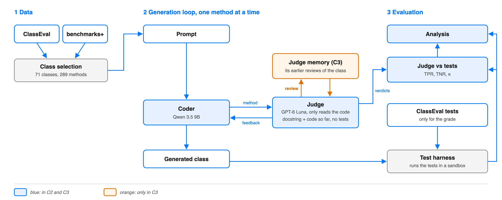

# Roadmap to the midway report (19 November 2026) and beyond

The midway report is at most 2 pages, uploaded on iCorsi by midnight of 19 November. It needs the
title, the team, the changes to the plan, the status with numbers, and a schedule until
16 December. Tick a box by changing `[ ]` into `[x]`.

Solid parts are built; orange, dashed parts are planned. The source is `architecture_base.svg`.

## Course dates

- 12 and 16 November: labs.
- 19 November: midway report, by midnight.
- 23 or 26 November: 1-to-1 meetings, if the instructors call us.
- 14 December: last lab.
- 16 December: final report, at most 10 pages plus 2 for references.
- 17 December: 5-minute presentation.

## Done

- [x] **Data and classes.** 71 of the 100 ClassEval classes, 289 methods (`select_classes.py`).
- [x] **Method order** (`order_methods.py`). Checked against the fields too: no change needed.
- [x] **Test harness** (5 Nov). References pass all 289 methods; 4 methods pass even as stubs.
- [x] **APIs** (6 Nov). Coder qwen3.8-27b in bf16 (qwen3.6-27b has no full-precision provider),
  judge GPT-6 Luna.
- [x] **Coder, setup C0** (6 Nov). One method per request, never seeing the tests.
- [x] **Judge v1 and v2** (6 Nov). v1 reads the code; v2 can also run it, up to 5 times.
- [x] **Pilot** (7 Nov, 10 development classes, 38 methods). Against the tests the judge looks close
  to chance (kappa at most 0.21). Against our labels of the 15 disputed methods it reaches 0.60,
  because the tests often check things the docstring does not say. With medium effort all the
  judge's concrete claims were true, so we keep the judge with medium effort.
- [x] **Setups C1 and C2 on the development classes** (7 Nov). C2: 3 methods fixed, 2 broken. C1:
  no change. Both start from worse first versions than C0, so the coder's randomness hides the
  effect of the feedback.
- [x] **Checks after the literature review** (8 Nov, `pilot_controls.py`). Rewriting the rejected
  methods without feedback does about as well as C2's revisions. The judge catches 15 of 22 failing
  methods of the 9B and 5 of 19 of the 27B, whose failures are mostly hidden requirements.

## Week 2 (9 to 15 November)

- [ ] **The judge on the pilot classes** (11 to 13 Nov), the instructors' first step. The 9B's
  methods of the 10 pilot classes are already written and graded (runs `C0-9b`, `C0-9b-r2`); we
  measure judge v2 on them (TPR, TNR, kappa) and try prompt variants, without the tests
  (`judge.py --version v3`, `v4`, `v5`; `compare_judges.py`). v3 judges only what the docstring
  asks, v4 fails only serious problems (after CodeJudge, Tong and Zhang 2024), v5 tries every
  behaviour the docstring names; v1 stays as the fallback if the judge may not run code. Rule
  fixed before the runs: a variant replaces v2 only if it gets more methods right than v2 by more
  than v2 differs from its own repeat, and the gain does not come from requirements found only in
  the tests (we read the changed verdicts). Otherwise v2 stays.
  Round 1 (11 Nov, 0.11 $): kappa 0.50 to 0.54 for every prompt; no variant changes more than 5
  of 71 verdicts, and the repeat of v2 changes 1. **v2 stays**; v1 is almost as good without
  running code. 11 of the 18 methods with a disagreement are wrong for every judge: mostly
  docstring and tests saying different things. Next: label them by hand on the 9B's code.
- [ ] **One full run of C2** (14 to 15 Nov) on the 61 test classes, with the 9B and the chosen
  judge prompt; then we tell the instructors the budget spent.
- [ ] **Analysis** (15 to 16 Nov). Pass rates with and without the weak methods, the judge's TPR
  and TNR, McNemar tests and bootstrap intervals (`analyze.py`).
- [ ] **Error analysis** (15 to 16 Nov). 20 disagreements between judge and tests, grouped into
  kinds, deciding each time who is right (`analyze.py --sample 20`).

## 16 to 19 November: midway report

- [ ] **Draft** (16 Nov), to bring to the lab.
- [ ] **Submission** (19 Nov).

## After the midway (20 November to 17 December)

- [ ] **C3, the flywheel** (20 to 29 Nov), if time and budget allow. Rounds of classes; between
  rounds the judge keeps a memory of its mistakes, confirmed by hand.
- [ ] **Later variants** (30 Nov to 6 Dec), the ones the instructors accept.
- [ ] **Full analysis** (7 to 11 Dec), answering RQ1, RQ2 and RQ3.
- [ ] **Final report** (7 to 16 Dec), with a draft at the lab of 14 December.
- [ ] **Presentation** (17 Dec).

## Decisions of 11 November (the instructors' answer)

- [x] **C1 is dropped**: the study is about feedback given step by step. C2 first, C3 if time and
  budget allow; the budget of C1 goes to more prompt trials for the judge.
- [x] **The judge never sees the tests.** It works only with what exists when the code is written:
  the docstring and the code so far. The tests only give the grade.
- [x] **The coder never sees the tests and runs no code.** Its memory is the judge's verdict in the
  prompt of the second attempt, which C2 already does.
- [x] **Coder: `qwen/qwen3.5-9b`**, which leaves more room for the feedback.
- [x] **One full run first**, then a report of the budget, then a decision on repetitions.
- [x] **Always a coder and a judge** (10 Nov). C0 and C4 are dropped. The baseline is the first
  version of each method, written before any feedback, against the final one.

## Later variants, to discuss with the instructors

Each comes with its reason and source.

- [ ] **Same first versions in every setup.** C2 and C3 start from the same first versions, written
  once with the same prompt, since two identical runs differ by 3 methods, as much as the feedback.
- [ ] **Our labels next to the tests, with TPR and TNR.** The paper judges its judge against human
  experts, and our tests and docstrings often disagree. We write the labelling criteria first,
  because people change them while labelling (Shankar et al. 2024, "criteria drift").
- [ ] **Feedback with evidence.** The coder also gets the code the judge ran and its output.
  Grounded critiques work better (CRITIC, Gou et al. 2024), and the judge's medium-effort claims
  were all true.
- [ ] **Judge v3, one docstring requirement at a time**, like the paper's ask module, with a third
  verdict, NOT SPECIFIED, that never reaches the coder. Both methods broken in C2 were correct code
  rejected for behaviour the docstring does not describe. Telling an underspecified task apart from
  a wrong solution works better as a separate step (Edwards and Schuster 2026). v3 also writes its
  checks from the docstring before reading the code, because tests written by a model carry a bias
  that can mislead the feedback (Chen et al., ACL 2025).
- [ ] **A careful memory in C3**: only corrections we confirm by hand, at most about ten. The
  paper found its memory module harmful, because errors spread to later verdicts.
- [ ] **C3 without the manual check.** Every disagreement between the judge and the tests goes into
  the memory as it is, as in the paper's memory module. Against C3 with the manual check, it shows
  how much the check matters.
- [ ] **C3 with a third model as reviewer.** A model of a third family, neither Qwen nor GPT, reads
  each disagreement (docstring, tests, code, the judge's reason) and decides in our place who is
  right. On the development classes we first compare it with our labels. Models tend to favour
  their own outputs (Panickssery et al. 2024); a model that judges a judge is the meta-judge of
  Wu et al. 2024, and a panel of different models is the jury of Verga et al. 2024.
- [ ] **Two controls**: empty feedback (NOT OK without the reason) and resampling (the method
  written again without feedback). They separate the effect of the reason from that of a second
  attempt; in a placebo-controlled study resampling did as well as feedback (Iscan 2026).
- [ ] **Count the revisions that change behaviour.** The coder must always rewrite, so it also
  follows wrong reviews (sycophancy, Sharma et al. 2024).
- [ ] **The judge as an evaluator.** TPR and TNR from the development classes correct the judge's
  pass rate on the other 61 classes (Rogan and Gladen formula).
- [ ] **pass^k if we repeat runs**: the share of methods that pass in all k runs (from τ-bench).

Sources: Zhuge et al. 2025 (the paper); Panickssery et al. 2024 (arXiv 2404.13076); Wu et al. 2024
(Meta-Rewarding, arXiv 2407.19594); Verga et al. 2024 (juries, arXiv 2404.18796); Shinn et al. 2023
(Reflexion, arXiv 2303.11366); Chen, Lin et al. 2024 (Self-Debug, arXiv 2304.05128); Edwards and
Schuster 2026 (arXiv 2603.26233); Chen et al. 2025 (ACL, 2025.acl-long.881); Iscan 2026 (arXiv
2606.31511); Gao et al. 2023 (ICML); Pan et al. 2024 (arXiv 2402.06627); Sharma et al. 2024 (arXiv
2310.13548); phase 14 (lessons 03 and 05), 16.23 and 18.02 of AI Engineering from Scratch
(https://github.com/DominikPanzarella/ai-engineering-from-scratch); lectures 4, 5, 6 and 14 of
Engineering AI Systems, USI
(https://www.composablesystems.org/courses/engineering-ai-systems/fa2026/).

## Open decisions

- [x] **Coder** (11 Nov): qwen3.5-9b. In the pilot it passed 61 to 68% of the methods (the 27B
  82%), and the judge caught 15 of its 22 failures.
- [x] **Repetitions** (11 Nov): one full run, then we decide with the instructors. A simulation on
  the 251 test methods: an effect like the pilot's is detected 16% of the time with one run, about
  48% with three.
- [x] **Same budget across setups**: one revision per method in C2.
- [x] **The lab note "classes with the 1st methods implemented"** meant the method order, already
  done.
- [x] **Coder memory and tests for the coder** (11 Nov): neither; see the decisions above.
- [ ] **Can the judge run code of its own (`run_python`)** on the class written so far? To ask at the
  lab of 12 November.
- [x] **Judge effort** (7 Nov). Medium: its claims were all true.
